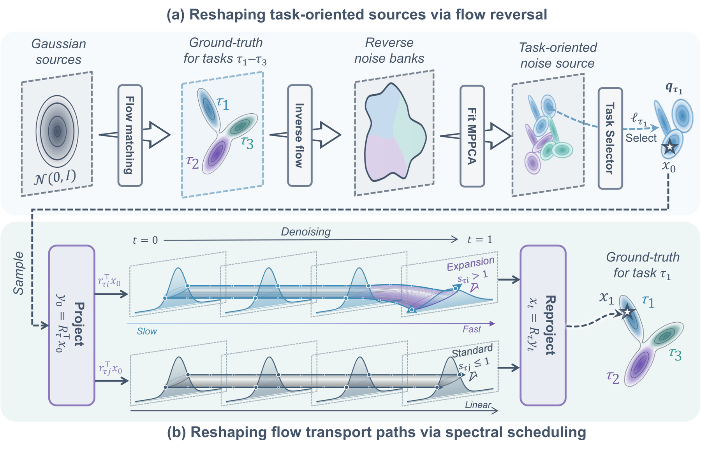
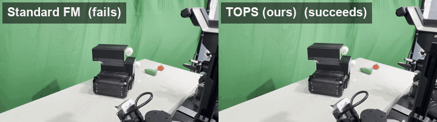

<div align="center">

# TOPS: Reshaping Flow Source and Transport for Multi-Task Robot Manipulation

**Tuo An<sup>1</sup>, Chuhao Zhou<sup>1</sup>, Jiahua Dong<sup>1</sup>, Jingliang Li<sup>1</sup>, Jiaqi Bai<sup>1</sup>, Jindou Jia<sup>1,†</sup>, Jianfei Yang<sup>1,†</sup>**

<sup>1</sup> MARS Lab, Nanyang Technological University &nbsp;·&nbsp; <sup>†</sup> Joint corresponding authors

[](https://ntumars.github.io/TOPS/)
[](https://arxiv.org/abs/2610.36694)
[](https://arxiv.org/pdf/2610.36694v1)


</div>

> [!NOTE]
> **Code coming soon.** We are preparing the training and evaluation code, the task-source construction and schedule scripts, and checkpoints for release. Watch or star this repository to be notified. Until then, the [project page](https://ntumars.github.io/TOPS/) has animated explanations of the method and all real-world rollouts.

<p align="center"></p>

## TL;DR

A flow-matching policy does not have to start every task from the same Gaussian, nor move along the same linear path. **TOPS (Task-Oriented Priors and Schedules)** fits a multimodal source to each task from reverse-mapped expert actions and slows, then accelerates, transport along the directions that need to expand. No change to the policy network, one integration step at inference.

* **Task-oriented source.** Expert action chunks are mapped back through a warm-up flow and fitted with a small per-task mixture, so the language instruction selects *where generation begins*.
* **Task-oriented schedule.** Guided by the source-target covariance mismatch, the interpolation slows the transition toward expert actions early in denoising and accelerates it later along directions that must expand.
* **Theory.** Under a Gaussian endpoint model, the schedule adjustment lowers an upper bound on velocity-prediction risk.
* **Practice.** One schedule-aware step (NFE = 2) beats ten-step Standard FM on LIBERO, LIBERO-Plus and CALVIN, transfers to π<sub>0.5</sub>, and improves real-world success.

## Abstract

Flow-based policies for language-conditioned multi-task manipulation commonly share a single Gaussian source prior and a common linear transport path across tasks. However, reliably executing multiple tasks with distinct motion requirements remains challenging for a shared policy. We introduce TOPS (Task-Oriented Priors and Schedules), which adapts the flow source prior and interpolation schedule to each task without modifying the network architecture. TOPS first constructs multimodal task sources from reverse-mapped expert action sequences, allowing language instructions to select where generation begins. Guided by source-target covariance mismatch, it then slows the transition toward expert actions early in denoising and accelerates it later along directions requiring expansion. Under a Gaussian endpoint model, our analysis shows that this schedule adjustment can lower an upper bound on velocity-prediction risk. Experiments on LIBERO, LIBERO-Plus, and CALVIN demonstrate improved performance across in-distribution, perturbation and cross-environment settings, alongside better data efficiency. Using one integration step, TOPS raises LIBERO-10 success from 53.44% to 69.67% compared with ten-step Standard Flow Matching (FM), while reducing inference time to approximately one-sixth of the baseline. TOPS also yields consistent gains when transferred to the large-scale flow-based π<sub>0.5</sub> policy across all four evaluated settings. Real-world experiments further demonstrate improved task success, including an increase from 20% with standard FM to 80% with TOPS on the upper-drawer opening task.

## Results

Mean ± s.d. over three training runs; success rate (%) on LIBERO, average completed chain length (of 5) on CALVIN. Ten-step baselines use an explicit midpoint solver (NFE = 20); TOPS uses one two-stage schedule-aware step (NFE = 2). See the paper for the full table.

| Method | NFE | LIBERO-10 (ID) | LIBERO-Plus (OOD) | Inference (ms) | CALVIN D→D (ID) | CALVIN ABC→D (OOD) | Inference (ms) |
|:--|:-:|:-:|:-:|:-:|:-:|:-:|:-:|
| Standard FM | 20 | 53.44 ± 2.93 | 27.11 ± 0.34 | 49.4 | 1.90 ± 0.05 | 0.70 ± 0.03 | 56.2 |
| MeanFlow | 1 | 59.00 ± 2.83 | 34.73 ± 0.32 | 5.7 | 1.89 ± 0.02 | 0.86 ± 0.02 | 5.4 |
| PriorGrad | 20 | 62.33 ± 0.24 | 30.56 ± 0.30 | 48.3 | 1.97 ± 0.06 | 1.02 ± 0.04 | 55.4 |
| **TOPS (ours)** | 2 | **69.67 ± 0.61** | **35.29 ± 0.08** | 8.2 | **2.27 ± 0.06** | **1.05 ± 0.04** | 9.0 |

**Transfer to π<sub>0.5</sub>** (same recipe on the official pi05_base checkpoint, one schedule-aware step vs. ten Euler steps): LIBERO-10 94.0 → 94.8, LIBERO-Plus 64.4 → 69.0, CALVIN D→D 3.673 → 3.941, CALVIN ABC→D 3.033 → 3.744.

**Real world** (8 tasks × 20 rollouts on a physical arm): TOPS succeeds in 124 / 160 trials (77.5%) vs. 82 / 160 (51.25%) for Standard FM; upper-drawer opening improves from 20% to 80%.

<p align="center"></p>
<p align="center"><sub>Upper-drawer opening, 2× speed. Left: Standard FM. Right: TOPS. All rollouts for the eight tasks are on the <a href="https://ntumars.github.io/TOPS/#realworld">project page</a>.</sub></p>

## Release plan

- [ ] Training and evaluation code (LIBERO, LIBERO-Plus, CALVIN)
- [ ] Task-source construction and schedule scripts
- [ ] Pretrained checkpoints
- [ ] π<sub>0.5</sub> integration
- [ ] Real-world deployment scripts

## Citation

```bibtex
@article{an2026tops,
  title   = {TOPS: Reshaping Flow Source and Transport for Multi-Task Robot Manipulation},
  author  = {An, Tuo and Zhou, Chuhao and Dong, Jiahua and Li, Jingliang and
             Bai, Jiaqi and Jia, Jindou and Yang, Jianfei},
  journal = {arXiv preprint arXiv:2610.36694},
  year    = {2026}
}
```

## Contact

Questions and collaboration: [jindou.jia@ntu.edu.sg](mailto:jindou.jia@ntu.edu.sg) · [jianfei.yang@ntu.edu.sg](mailto:jianfei.yang@ntu.edu.sg)
